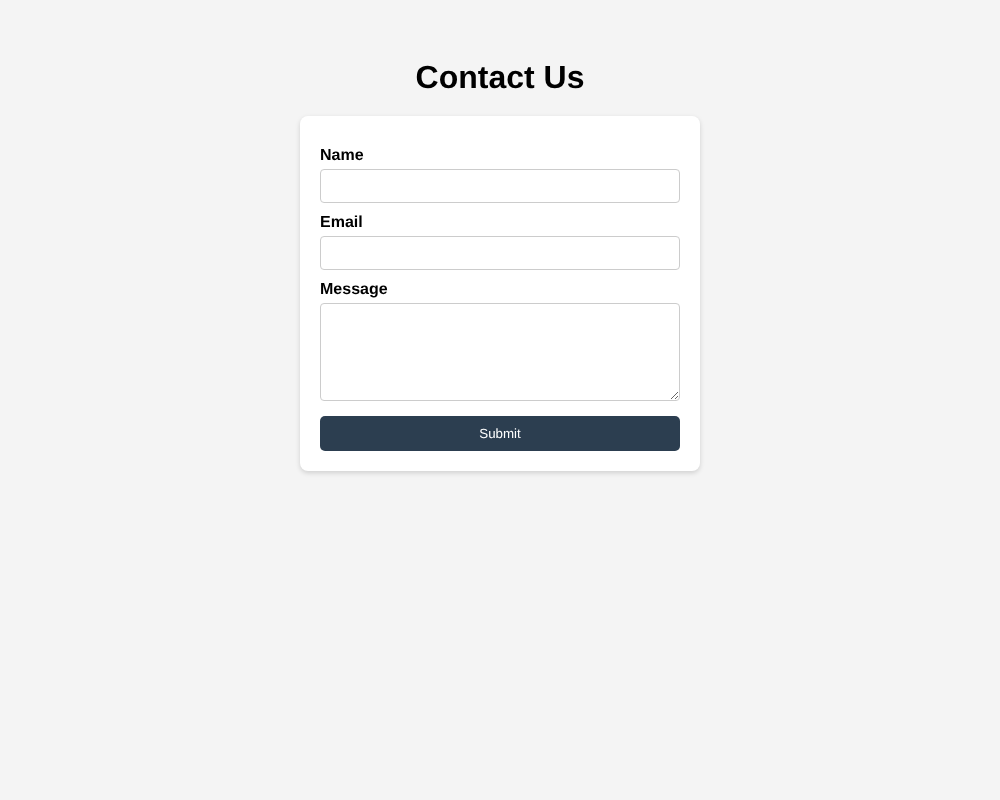
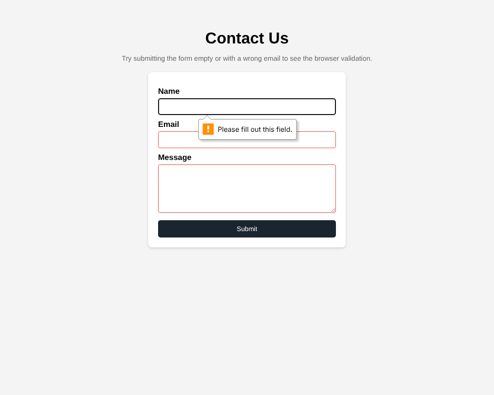
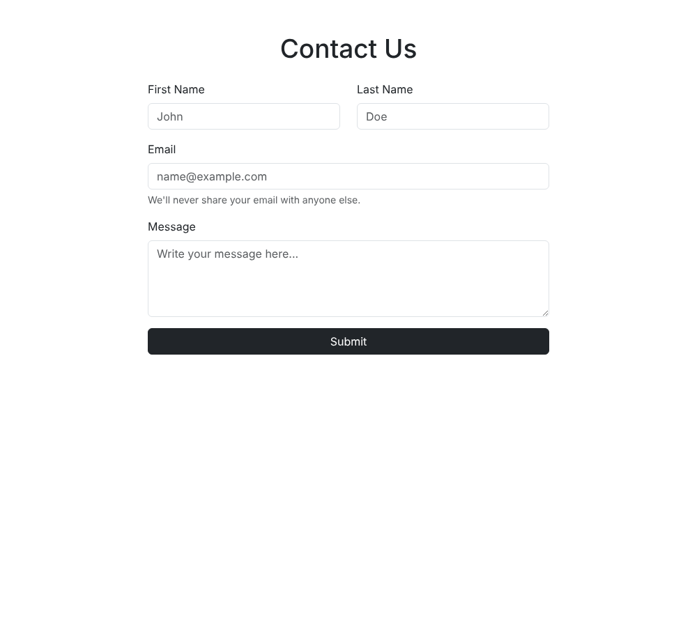
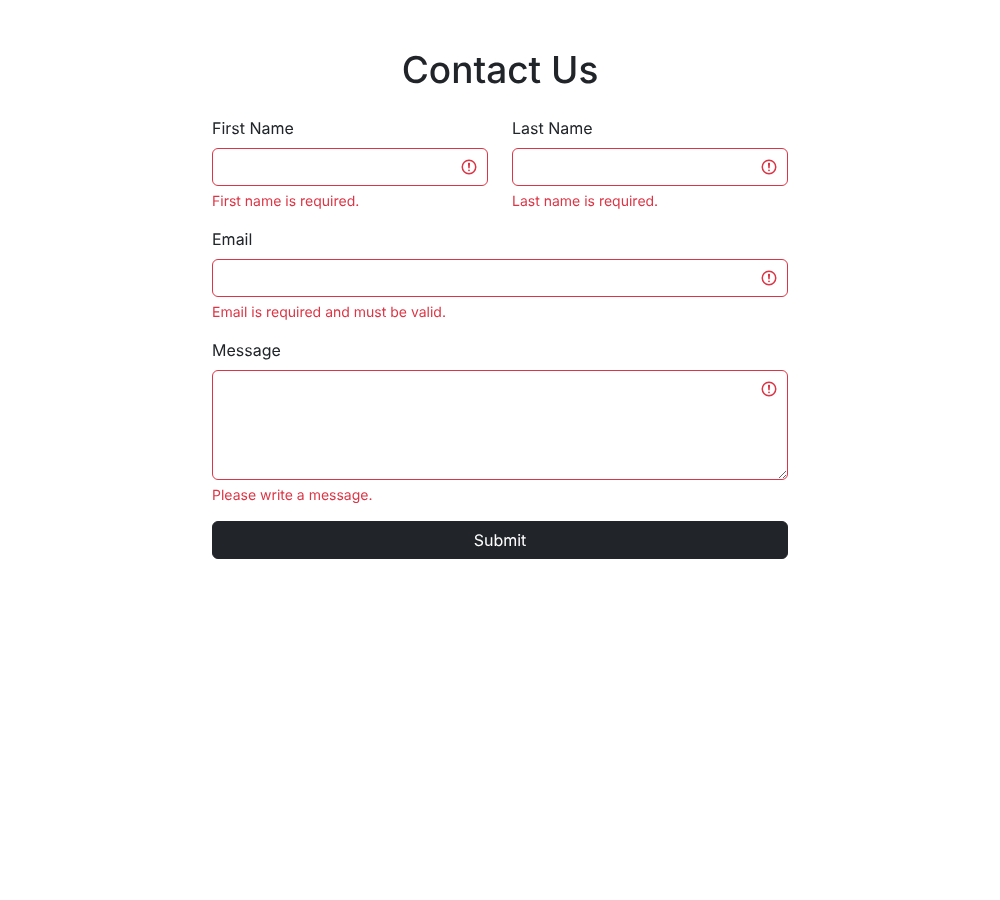
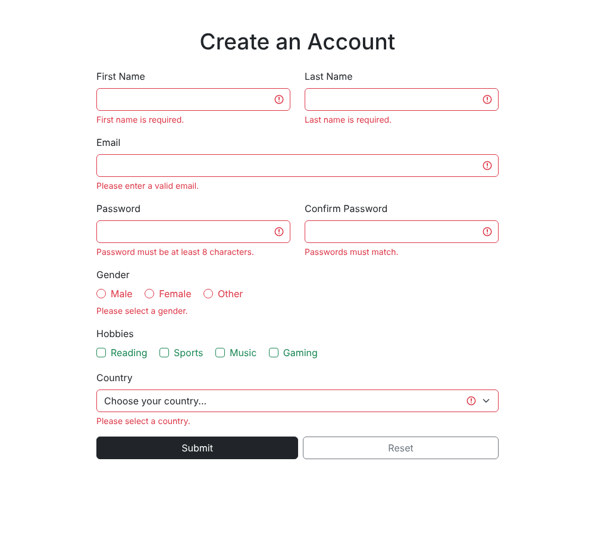

# Assignment 4 - Forms and Validation

**Name:** [Dinmukhammed Dauletkhan]
**Group:** [SE-2538]

## Task 0 - Simple Contact Form
A basic contact form with Name, Email and Message fields, each with a proper `<label>`, and a submit button.

Screenshot:

## Task 1 - Form with HTML5 Validation
Same contact form, with `required`, `minlength`, `maxlength` and `type="email"` added so the browser blocks submission on empty or invalid fields.

Screenshot (empty submit triggers the browser's validation message):

## Task 2 - Bootstrap Form Styling
The contact form rebuilt with Bootstrap form classes (`form-control`, `form-label`) and the Bootstrap grid (`row` / `col-md-6`) to place First Name and Last Name side by side. Includes placeholders and helper text.

Screenshot:

## Task 3 - Bootstrap Validation Styles
Bootstrap's custom validation styling (`needs-validation`, `was-validated`) with `is-valid` / `is-invalid` feedback messages shown under each field after submit.

Screenshot (after submitting empty):

## Task 4 - Registration Form
A full registration form: First/Last Name, Email, Password + Confirm Password, Gender (radio), Hobbies (checkboxes), Country (select), Submit and Reset buttons. Styled with Bootstrap Grid for a responsive layout, HTML5 validation (`required`, `minlength="8"` for password) and Bootstrap validation feedback. A small script also checks that password and confirm password match.

Screenshot (after submitting empty):

## Summary
For this assignment I worked through plain HTML forms first and then moved to Bootstrap. Task 0 and Task 1 were pretty simple once I understood what each validation attribute does, and testing them in the browser was straightforward since Chrome shows its own validation popups automatically. Bootstrap took a bit more time to get used to, mostly figuring out that the validation feedback doesn't show up by itself - you need the was-validated class added through JavaScript after the form is submitted, which I copied from the Bootstrap docs. The registration form in Task 4 was the most work because it combines everything: HTML5 validation, Bootstrap grid for layout, and a custom check to make sure the two password fields match. Overall I understood the difference between the two validation approaches better: HTML5 validation is quick and built into the browser, while Bootstrap validation gives more control over how the messages look but needs a little bit of JavaScript to work properly.
